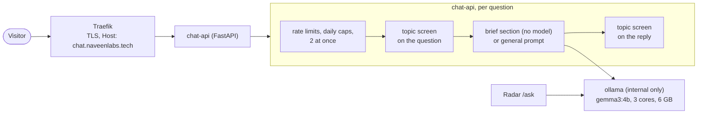

# naveenlabs-ai

Self-hosted AI stack on the VPS: a local model runtime (Ollama), the public **Chat** page
(`https://chat.naveenlabs.tech`, the Chat planet on naveenlabs.tech), and private automation tools (n8n, Flowise).

Status (2026-10-09): Chat and Ollama are deployed and healthy. n8n and Flowise are configured but not running.

## Services

| Service | Address | Access | What it is |
|---|---|---|---|
| chat-api (Chat) | `chat.naveenlabs.tech` | public | Static chat page plus a thin, guarded API in front of the model |
| ollama | internal only | none | Model runtime (`ollama/ollama:0.35.0`, capped at 3 of 4 CPU cores and 6 GB, model never unloaded: a cold load can outlast chat-api's 60 s timeout). No Traefik route; only chat-api, n8n, Flowise and Radar reach it at `http://ollama:11434` |
| n8n | `127.0.0.1:5678` (SSH tunnel) | private, Basic Auth | Workflow automation. Never public: its nodes can run shell commands |
| flowise | `127.0.0.1:3000` (SSH tunnel) | private, Basic Auth | Low-code LLM app builder on the same Ollama |

Open the private tools with `ssh -L 5678:127.0.0.1:5678 -L 3000:127.0.0.1:3000 root@VPS`. They must never get a
public hostname (other products' names and admin logins; see the hosting-policy rules).

**Chat's look:** its own "soft conversational" theme in `chat-api/static/` (lavender, DM Sans, speech-bubble mark,
soft filled icons in `icons.svg`), light by default with the shared light/dark toggle. One column: greeting, a pill composer
pinned at the top, six project cards (they fold away once a chat starts, a "Projects" button brings them back),
then the conversation; answers render headings and lists from a small Markdown subset, never as HTML.
`chat-api/test_page.py` checks tokens, contrast, budgets and markup.

## Why Chat is a separate service instead of exposing Ollama

Ollama's API has no authentication and no limits. `chat-api/main.py` is the only public piece and adds:

- **Limits:** 10 requests per minute per visitor, 50 per visitor per day, 1,000 per day for the whole site
  (`CHAT_DAILY_PER_VISITOR`, `CHAT_DAILY_TOTAL`), at most 2 generations at once (`CHAT_MAX_CONCURRENT`, others get
  503 with `Retry-After`), replies capped at 600 tokens and streamed, questions at 1,000 characters.
- **Guardrails:** a topic screen on the question and on the reply (weapons, malware, phishing and scams, drugs,
  sexual content); self-harm questions get a supportive reply with the Tele-MANAS helpline (14416); a system prompt
  that refuses harmful requests, gives no medical, legal or financial advice and never claims to speak for a company.
  The screen is a keyword list, not a classifier; the system prompt is the second layer.
- **Security headers** on every response: strict CSP, HSTS, `nosniff`, `frame-ancestors 'none'`, permissions policy.
  API docs are turned off.
- **Visitor identity behind the proxy:** the rightmost `X-Forwarded-For` entry (`TRUST_PROXY=1`).
- **`/healthz`** for the Docker health check and the external uptime probe.

The limiter and counters are in memory: one container on a personal site, so a restart resetting them is acceptable.

## Model

Chat runs **gemma3:4b** (Google, open weights, ~3.3 GB). Chosen on 2026-10-04 by benchmarking on this server
(4 vCPU AMD EPYC, no GPU) with the live prompt and reply cap:

| Model | Avg reply | Quality on the test questions |
|---|---|---|
| qwen2.5:1.5b (before) | 1.8 s | invented facts |
| llama3.2:3b | 4.2 s | mixed |
| **gemma3:4b** | 4.7 s | all correct |

- **Project briefs:** a small model knows nothing about naveenlabs.tech and invents answers about it, so each
  project has a checked brief in `chat-api/briefs/` (intro, architecture, strengths, intelligence; a short and a
  detailed form). A project question (it names a project, or follows up on the last brief shown) gets the model
  with that project's whole brief in detailed form, `PROJECT_PROMPT`'s strict rules and temperature 0; code then
  checks every number in the answer against the brief and replaces the answer with the checked section if one is
  not there. Anything else gets the model with the short `BASE_PROMPT`. "Show the checked brief" returns the brief
  without the model. Project answers start after about 15 to 20 s (the model reads about 1,000 to 1,400 tokens).
  **When a project's ARCHITECTURE.md changes, re-check its brief against it; keep `BASE_PROMPT`'s project list in
  step with the landing page's Work list.** Never put a broker or exchange brand, a server address or a private
  tool in a brief (a test checks).
- **CPU:** a reply used all 4 cores, starving the trading apps, so Ollama is capped at `cpus: "3.0"` and the model
  runs with `num_thread: 3` (`CHAT_MODEL_THREADS`). Typical replies take 7-10 s, long ones about 15 s.
- **Memory:** 6 GB cap (gemma ~3.6 GB loaded plus Radar's `nomic-embed-text`; at 4 GB, two loaded models were killed).
- To change models: `docker compose exec ollama ollama pull <model>`, set `CHAT_MODEL`, check speed and quality first.

## Container hardening

chat-api runs as a non-root user with a read-only filesystem, all Linux capabilities dropped,
`no-new-privileges`, 0.5 CPU and 256 MB, and a health check. Python dependencies and every image (Ollama, n8n, Flowise) are pinned.

## Tests

```powershell
cd chat-api
python -m pip install -r requirements-dev.txt   # the app's pins plus pytest and httpx
python -m pytest -q        # briefs and routing, streaming, limits, guardrails, daily caps, self-harm reply, headers, page theme and markup
```

## Deploy (VPS)

Source is on GitHub (private `dsnaveenkumar15/naveenlabs-ai`); the files are copied to the server:

```bash
# from the laptop, in this directory
tar --exclude=.git --exclude=.venv --exclude=__pycache__ --exclude=.pytest_cache -cf - . \
  | ssh root@VPS "tar -xf - -C /opt/naveenlabs-ai"
# on the VPS
cd /opt/naveenlabs-ai && docker compose up -d --build ollama chat-api
docker inspect -f '{{.State.Health.Status}}' naveenlabs-ai-chat-api-1      # wait for "healthy"
docker compose exec ollama ollama pull gemma3:4b                         # first deploy only
docker compose exec ollama ollama run gemma3:4b "Say ok."                # after any ollama restart: load the model once
```

The warm-up matters: a cold load can take longer than chat-api's 60 s timeout, and a timed-out request aborts the
load, so without it every visitor gets "Model unavailable". `OLLAMA_KEEP_ALIVE=-1` then keeps the model loaded.

DNS: an A record `chat` pointing at the VPS. Only `chat` is public.

## Architecture

A visual walkthrough for presenting: [`docs/explainer.html`](docs/explainer.html) (open it in a browser; the 3D
views need an internet connection for three.js).



The browser loads the static page from chat-api and posts each question to `/api/chat`. Ollama has no route from
outside the Docker network; chat-api is the only public piece and adds every limit and guardrail. Radar's `/ask`
uses the same Ollama for embeddings (`nomic-embed-text`).

## Completed work

| Date | Work |
|---|---|
| 2026-09-25 | Stack defined: Ollama, chat-api, n8n, Flowise |
| 2026-10-02 | n8n and Flowise private; per-visitor rate limit behind the proxy, concurrency and reply caps; guardrails (topic screen, self-harm helpline reply); Chat named and given its hostname |
| 2026-10-03 | Shared product design with dark mode; hardened container (health endpoint, security headers, non-root, read-only); light/dark toggle shared across sites |
| 2026-10-04 | Model benchmarked on the server and switched to gemma3:4b; answers about the site come from a fact sheet; Ollama capped at 3 cores and 6 GB |
| 2026-10-07 | "Soft conversational" theme, one-column home with topic cards, typing indicator; model never unloaded (cold load outlasted the timeout); facts mention the Architect and Red Team |
| 2026-10-08 | Facts no longer describe the private trading systems (a test forbids it) |
| 2026-10-11 | Pushed to a private GitHub repository |
| 2026-11-12 | Engineering explainer deck (`docs/explainer.html`): 13 slides in Chat's own look, with 3D views of a question's path through the gates, exposure as terraces, the model benchmark and the shared CPU and memory budget; three live questions quoted with their measured times |
